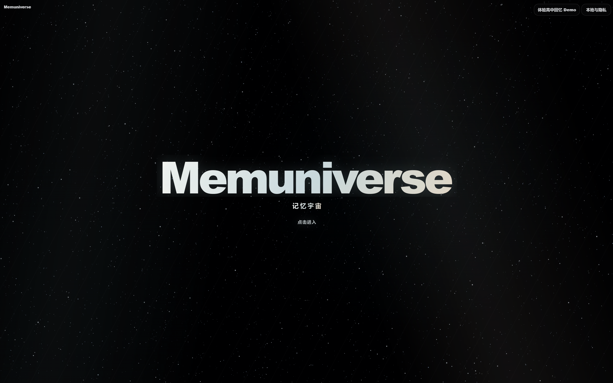

# Memory Universe · 记忆宇宙

将照片、音乐与故事组织成可探索的 3D 记忆空间，从时间、人物、地点与情绪重新走近一段回忆。

[在线演示](https://memory-universe-two.vercel.app/) · [体验路径](#三分钟体验) · [本地开发](#本地开发) · [隐私说明](PRIVACY.md)



> **当前完整演示：高中回忆「那年夏天」。** 使用预设元数据、内置照片、本地音轨与确定性模板引擎；在线 AI 整理尚未接入。

## 让回忆保留关系

照片库擅长保存文件，却很难保留照片之间的人物关系、情绪与叙事。Memory Universe 面向希望重访某段生活的个人与家庭，用空间、主题和连续音乐时间线组织体验。

```text
选择主题 → 添加回忆 → 选择音乐 → 组织故事 → 探索 3D 空间 → 深入查看或导出
```

- **多种观察方式**：按时间、人物、地点与情绪理解记忆之间的关系。
- **空间探索**：通过聚合、距离与移动浏览照片，打开单条记忆或创建星座。
- **音乐时间线**：选用内置音轨，或为当前会话上传 MP3/WAV；不需要第三方音乐账号。
- **本地优先**：个人照片、元数据、衍生图像、布局与备份默认保存在当前浏览器。

## 三分钟体验

1. 打开[在线演示](https://memory-universe-two.vercel.app/)。
2. 点击 **体验高中回忆 Demo**，选择 **高中回忆 / 那年夏天**。
3. 跟随时间线进入 3D 记忆空间，切换时间、人物、地点与情绪视角。
4. 打开一条记忆、创建星座或重新播放。
5. 打开音乐层切换音轨，或上传自己的 MP3/WAV 供本次会话使用。

高中回忆演示包含 96 张内置照片和本地音轨，无需账号或导入照片。默认使用「特别的人」音轨；音乐输入不参与视觉分析，也不决定场景风格。

## 已实现与后续范围

| 范围 | 当前状态 |
| --- | --- |
| 高中回忆 / 那年夏天 | 完整的确定性公开 Demo |
| 个人素材导入、归档、备份与导出 | 已有本地流程 |
| 系统音轨与用户上传音乐 | 系统音轨随站点部署；上传音乐限当前浏览器会话 |
| 恋爱、分手、大学、工作、自定义主题 | Coming Soon，尚未完成 |
| 在线 AI 整理、跨设备同步与分享 | 后续范围 |

未来 AI 整理的设计流程是：照片、EXIF 与笔记进入主题上下文，生成聚类、标签与故事建议，由用户确认、编辑或拒绝，再保存可逆元数据。此流程是接入方向，不是当前 Demo 已调用在线模型的证明。

## 技术实现

- React 19、TypeScript、Vite、React Router。
- Three.js、React Three Fiber、Drei 构建空间场景。
- Zustand 管理场景、模板、音乐和界面状态。
- IndexedDB 保存个人照片、EXIF、衍生图片、布局与备份。
- EXIFReader、pica、fast-average-color 处理浏览器端图像。
- fflate、Mediabunny 支持备份与本地导出；Vitest、Testing Library、Playwright 用于回归测试。

## 本地开发

环境要求：Node.js 20.19+ 与 pnpm 11。

```bash
pnpm install
pnpm dev
```

访问 Vite 输出的开发地址。检查命令：

```bash
pnpm run lint
pnpm run typecheck
pnpm test
pnpm run build
```

## 项目文档

| 产品与设计 | 工程与发布 |
| --- | --- |
| [案例研究](docs/case-study.md) · [产品故事](docs/product-story.md) | [项目分析](docs/PROJECT_ANALYSIS.md) |
| [用户流程](docs/user-flow.md) · [设计决策](docs/design-decision.md) | [隐私边界](PRIVACY.md) |
| [演示脚本](docs/demo-script.md) | [发布检查清单](docs/PUBLISHING_CHECKLIST.md) |

## 隐私、素材与许可

不要提交真实个人照片、GPS/EXIF 数据、备份、Token 或音乐会话。演示素材来源与授权信息见 [`CREDITS.md`](CREDITS.md) 和 [`demo-asset-credits.json`](public/demo/demo-asset-credits.json)。

仓库尚未声明最终开源许可证。复用前需确认代码、依赖、图片与音频的使用权，公开可访问不等于可任意再分发。
